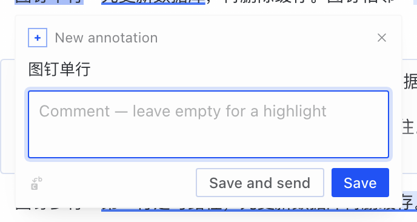
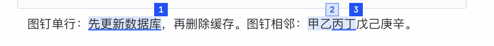
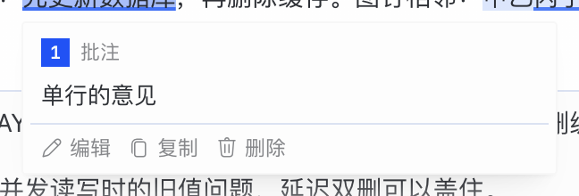
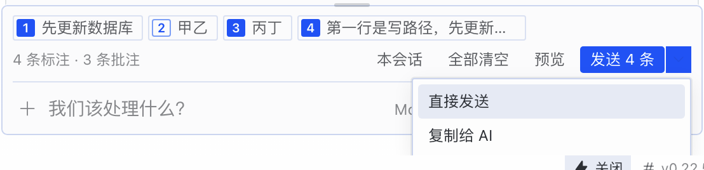

[English](README.md) | [简体中文](README.zh.md) | [繁體中文](README.zh-hant.md) | [日本語](README.ja.md) | [العربية](README.ar.md) | [Русский](README.ru.md) | **Français** | [Deutsch](README.de.md) | [Español](README.es.md)

# Diple — surlignez et commentez des passages de conversation pour l’IA (plugin Hermes Desktop)

Surlignez un passage dans une conversation Hermes Desktop, ajoutez-y un commentaire si vous le souhaitez, et envoyez-en un lot avec votre prochain message ; l’IA répond à chaque commentaire un par un, et vous pouvez passer de chaque réponse à son passage.

> **Le nom.** La *diple* (›) est le signe que les copistes grecs anciens traçaient dans la marge pour relier une ligne à son commentaire — l’ancêtre du guillemet. Le nom chinois 圈批 signifie « marquer et commenter ».

> **Non officiel.** Ce plugin est communautaire. Il n’est ni conçu, ni vérifié, ni pris en charge par Nous Research ou le projet Hermes Agent.

## Fonctionnalités

- **Annoter une sélection** — sélectionnez du texte dans n’importe quel message et, dès que vous relâchez la souris, un bouton **Annoter** apparaît à côté (ou appuyez sur <kbd>⌘⇧E</kbd>). Le passage garde son origine : quelle session, quel message, qui l’a dit.
- **Surlignage ou commentaire** — chaque passage ajouté est une *annotation*. Écrivez un commentaire et c’est un *commentaire* (l’IA doit y répondre) ; laissez-le vide et c’est un *surlignage* (simple contexte).
- **Commenter sur place** — un petit éditeur s’ouvre à côté du passage : le passage en haut (Markdown rendu), votre commentaire dessous, et **Enregistrer** / **Enregistrer et envoyer** en bas, avec un bouton icône pour remplacer le passage par la sélection actuelle.
- **Épingles sur l’original** — le texte annoté est ombré (les commentaires sont aussi soulignés) et reçoit une épingle numérotée en haut à droite. Survolez une épingle pour une carte à trois boutons : **Modifier** (ou **Ajouter un commentaire** sur un surlignage), **Copier** et **Supprimer** ; une annotation envoyée ne propose que **Copier**.
- **Une bande au-dessus de la zone de saisie** — les annotations enregistrées y attendent, par session, sous forme de pastilles numérotées jusqu’à l’envoi. Cliquez sur une pastille pour revenir au passage ; supprimez, effacez tout (annulable) ou prévisualisez ; la liste survit aux rechargements.
- **Envoyer N ▾** — envoyez avec votre prochain message, ou cliquez sur **Envoyer N** pour n’envoyer que les annotations. Le menu ▾ propose **Envoyer maintenant** et **Copier pour l’IA** (Markdown, rien n’est envoyé).
- **Marqueurs de réponse** — l’IA marque chaque paragraphe qui répond à un commentaire ; l’app l’affiche comme une petite pastille « ↩ Commentaire 2 » qui ramène au passage.
- **Avis de réponse manquante** — quand une réponse saute un commentaire, vous êtes prévenu (« Le commentaire 2 n’a pas eu de réponse ») et pouvez le remettre dans la liste d’attente d’un clic.
- **Aller-retour sans clignotement** — revenir à un passage ne fait défiler que s’il est hors écran, et le passage reste accentué, sans clignoter.
- **File d’attente pendant la réponse** — tant que l’IA répond, « Envoyer après la réponse » met le lot en file et l’envoie à la fin du tour.
- **Aperçu avant envoi** — voyez exactement ce que la bulle de discussion affichera et ce que l’IA recevra, avec une estimation de taille par rapport aux limites de contexte de l’hôte.

L’interface du plugin est disponible dans toutes les langues de Hermes Desktop : **English, 简体中文, 繁體中文, 日本語, العربية, Русский, Français, Deutsch et Español** (l’arabe de droite à gauche). Par défaut, elle suit la langue de l’application ; vous pouvez aussi en choisir une dans les réglages du plugin. Les consignes envoyées à l’IA restent en chinois pour les deux interfaces chinoises et en anglais pour toutes les autres langues.

## Captures d’écran

L’éditeur à côté d’un passage (interface en anglais) :



Épingles numérotées en haut à droite de chaque passage ; les épingles voisines se décalent (interface en chinois et texte d’exemple) :



La carte qui s’affiche au survol d’une épingle, avec Modifier · Copier · Supprimer :



La bande au-dessus de la zone de saisie et le menu Envoyer N ▾ (Envoyer maintenant, Copier pour l’IA) :



Les captures ont été faites dans un bac à sable avec des conversations inventées.

## Installation

Le plugin a deux moitiés : un plugin de bureau (`plugin.js`) et un petit backend Python (`plugins/diple/`). Les deux sont nécessaires. Dans les commandes ci-dessous, `~/.hermes` est votre dossier Hermes ; pour un profil nommé, utilisez `~/.hermes/profiles/<nom>`.

### Option A : télécharger une version

1. Téléchargez `plugin.js`, `plugin.js.sha256`, `diple-python-0.1.0.zip` et `diple-python-0.1.0.zip.sha256` depuis la [dernière version](https://github.com/waiclay-349687/hermes-diple/releases), puis vérifiez-les :

   ```bash
   shasum -a 256 -c plugin.js.sha256
   shasum -a 256 -c diple-python-0.1.0.zip.sha256
   ```

2. Mettez-les en place :

   ```bash
   mkdir -p ~/.hermes/desktop-plugins/diple ~/.hermes/plugins
   cp plugin.js ~/.hermes/desktop-plugins/diple/plugin.js
   unzip -o diple-python-0.1.0.zip -d ~/.hermes/plugins/
   ```

3. Activez le backend et redémarrez Hermes Desktop :

   ```bash
   hermes plugins enable diple
   ```

### Option B : depuis les sources

Nécessite Node.js 22 ou plus récent.

```bash
git clone https://github.com/waiclay-349687/hermes-diple.git
cd hermes-diple
npm install
node scripts/install.mjs --home ~/.hermes --no-enable
hermes plugins enable diple
```

`scripts/install.mjs` construit `plugin.js` et copie les deux moitiés dans le dossier Hermes indiqué par `--home` (il n’en devine jamais un). Redémarrez ensuite Hermes Desktop : la moitié Python ne se charge qu’au démarrage de l’application.

## Utilisation

1. Sélectionnez du texte dans un message et cliquez sur **Annoter** à côté de la sélection (ou appuyez sur <kbd>⌘⇧E</kbd>). L’éditeur s’ouvre à côté du passage.
2. Écrivez un commentaire si vous voulez, puis appuyez sur <kbd>Entrée</kbd> ou **Enregistrer** ; un commentaire vide enregistre un surlignage. L’annotation reçoit une épingle numérotée et une pastille au-dessus de la zone de saisie. Ajoutez-en autant que vous voulez, de cette session ou d’autres.
3. Écrivez votre message et envoyez-le comme d’habitude, ou cliquez sur **Envoyer N** (ou <kbd>⌘⇧↩</kbd>) pour n’envoyer que les annotations. Une ligne de reçu sous votre message (« 3 annotations jointes · Voir ce que l’IA a reçu ») montre ce qui est parti.
4. Dans la réponse, cliquez sur une pastille « ↩ Commentaire n » pour revenir à son passage. Si un commentaire a été sauté, utilisez **Remettre** dans l’avis.

**Copier** sur une carte d’épingle copie le texte d’un surlignage, et un commentaire en Markdown : le passage en citation (`> ` devant chaque ligne), une ligne vide, puis votre commentaire — le même format que **Copier en Markdown** dans « Annotations de cette session ». Pour refaire d’un commentaire un surlignage, videz son commentaire et enregistrez.

Pendant que l’IA répond, <kbd>Entrée</kbd> oriente le tour en cours et les annotations ne partent jamais avec une orientation ; utilisez plutôt **Envoyer après la réponse**.

### Raccourcis

| Action | Par défaut | Remarques |
| --- | --- | --- |
| Ajouter la sélection à la liste d’attente | <kbd>⌘⇧E</kbd> | Modifiable dans les raccourcis clavier de l’application |
| Envoyer la liste d’attente | <kbd>⌘⇧↩</kbd> | Modifiable |
| Envoyer depuis la bande | <kbd>⌘↩</kbd> | Quand le focus est dans la bande au-dessus de la zone de saisie |

Les surfaces de travail (bouton, éditeur, épingles, bande, menus) n’affichent pas ces touches ; la page de réglages du plugin les liste.

Sous Windows et Linux, <kbd>⌘</kbd> correspond à <kbd>Ctrl</kbd>. La palette de commandes (<kbd>⌘K</kbd>) propose aussi « Ajouter à la liste d’attente », « Diple : Envoyer les annotations en attente », « Diple : Aperçu de ce que l’IA recevra », « Diple : Annotations de cette session » et « Diple : Réglages » (dans la langue de l’interface).

## Réglages

Ouvrez-les depuis la palette de commandes (« Diple : Réglages ») ou depuis les réglages de l’application.

| Réglage | Par défaut | Effet |
| --- | --- | --- |
| Activer Diple | activé | Interrupteur général. Désactivé, il arrête les raccourcis, la liste, le surlignage des passages ajoutés et l’interaction avec les marqueurs ; les données sont conservées. |
| Afficher la barre d’outils à la sélection | activé | Le bouton **Annoter** à côté d’une sélection. Désactivé : utilisez <kbd>⌘⇧E</kbd> ou la palette de commandes. |
| Langue | Suivre l’application | Suivre l’application, ou l’une des neuf langues, chacune affichée sous son propre nom. Concerne l’interface du plugin ; les consignes envoyées à l’IA sont en chinois pour 简体中文 / 繁體中文 et en anglais sinon. |
| Mode discret : épingles seules sur l’original | désactivé | Les passages annotés n’ont ni fond ni soulignement, seulement une épingle numérotée à côté. |
| Garder les marques après l’envoi | activé | Les annotations envoyées gardent une marque estompée sur l’original, avec « répondue » / « sans réponse » sur l’épingle. |
| Raccourcis | — | Ouvre les raccourcis clavier de l’application pour réassigner les deux actions. |
| Réinitialiser | — | Rétablit les valeurs par défaut (la langue est conservée). |

## Fonctionnement

### Ce que reçoit l’IA

La bulle de conversation reste courte : votre texte, puis une ligne par annotation (numéro, origine, les ~40 premiers caractères, votre commentaire) et une dernière ligne `@diple:<id du lot>`. Cette ligne est une référence de contexte Hermes : à l’envoi du tour, le backend du plugin la développe en **version complète** — le texte intégral de chaque annotation, son origine, son auteur et son commentaire, plus de courtes règles de réponse (répondre à chaque commentaire ; les surlignages ne sont que du contexte). Un passage de plus de 4000 caractères garde ses 1500 premiers et 1500 derniers. Utilisez **Aperçu** avant l’envoi, ou **Voir ce que l’IA a reçu** après, pour voir les deux versions.

### Marqueurs de réponse

Les règles de réponse demandent à l’IA de placer un marqueur comme `::ann{b="<id du lot>" n="1,3"}` devant chaque paragraphe qui répond aux commentaires 1 et 3. Hermes Desktop affiche ces directives ; le plugin les dessine comme des pastilles « ↩ Commentaire 1, 3 » et cherche dans la réponse les commentaires restés sans marqueur. Les marqueurs dans du code sont ignorés.

### Où sont stockées les données

- La liste d’attente et l’état d’envoi : le stockage des plugins de bureau de Hermes Desktop (stockage local de l’application, clés préfixées `hermes.plugin.diple.`).
- Les lots envoyés (nécessaires pour développer les références `@diple:` et montrer ce que l’IA a reçu) : SQLite dans `~/.hermes/plugin-data/diple/data.db`.

Les décisions de conception sont consignées dans [docs/adr](docs/adr/README.md) et la structure d’ensemble dans [docs/architecture.md](docs/architecture.md).

## Confidentialité

Tout reste sur votre machine. Le plugin ne fait aucune requête réseau de lui-même, n’a pas de télémétrie et ne stocke rien hors de votre dossier Hermes et du stockage local de l’application. Les annotations n’atteignent votre fournisseur de modèle que dans un message que vous envoyez, exactement comme le texte que vous tapez.

## Limites connues

Les principales (liste complète avec leurs raisons dans [docs/known-limitations.md](docs/known-limitations.md)) :

- Deux fenêtres qui écrivent la liste d’attente de la même session au même instant peuvent perdre l’une des deux écritures.
- Une annotation prise pendant que la session est occupée est vérifiée par rapport au tour qui l’a produite ; si cela ne peut pas être établi, elle reste marquée « non vérifiée » plutôt que devinée.
- Après que l’application a changé l’id d’une session (par exemple après une compression du contexte), redévelopper une ancienne référence `@diple:` dans la nouvelle session est refusé.
- Il n’y a pas encore d’entrée dans le menu contextuel : Hermes Desktop n’offre pas de point d’extension du menu contextuel aux plugins.

## Compatibilité

Testé avec Hermes Agent **v0.22.5 (2026.9.24)**, commit `bf0203a` (2026-10-22), sur macOS. Nécessite Hermes Desktop (la CLI seule ne charge pas les plugins de bureau). D’autres versions peuvent fonctionner mais n’ont pas été testées ; merci de signaler ce que vous constatez.

## Ce qui le distingue

Le catalogue sélectionné contient un plugin de bureau apparenté, **quote-ask** (`hermes plugins info quote-ask`) : le texte sélectionné arrive dans la zone de saisie sous forme de citation Markdown. Il est léger et sans état. Diple sert à relire une longue réponse : il garde une liste d’attente d’un envoi à l’autre, donne à chaque commentaire un numéro auquel l’IA doit répondre, vérifie les réponses manquantes, relie réponses et passages dans les deux sens, et envoie le texte intégral via une référence de contexte tandis que la bulle reste courte. Diple adapte le convertisseur « sélection → Markdown » de quote-ask (MIT, voir [THIRD_PARTY_NOTICES.md](THIRD_PARTY_NOTICES.md)). Les id de plugin diffèrent (`quote-ask` et `diple`), les deux peuvent donc être installés côte à côte.

## Feuille de route et tickets

- [ROADMAP.md](ROADMAP.md) — ce qui est en cours, ce qui suit et ce qui viendra plus tard.
- [Issues](https://github.com/waiclay-349687/hermes-diple/issues) — questions ouvertes, discussions de conception et limites connues.
- [CHANGELOG.md](CHANGELOG.md) — ce qui a changé dans chaque version.
- [CONTRIBUTING.md](CONTRIBUTING.md) — compilation et tests.

## Licence

[MIT](LICENSE). Code tiers : [THIRD_PARTY_NOTICES.md](THIRD_PARTY_NOTICES.md).
